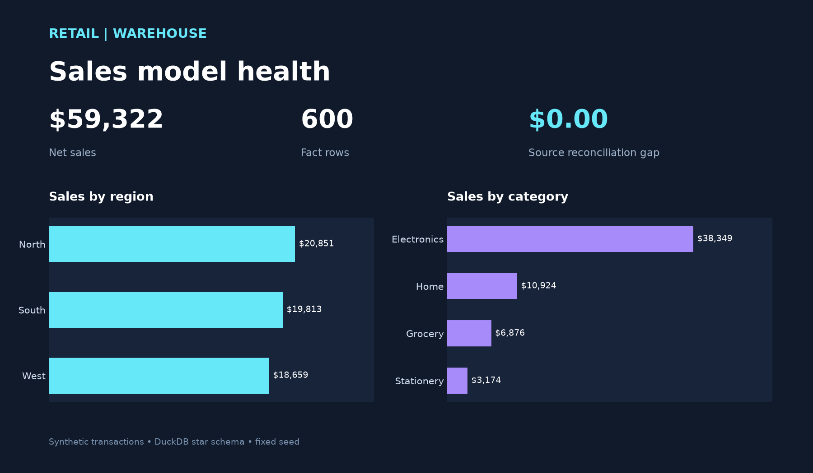

# Retail Data Warehouse

A reproducible star schema for synthetic retail order lines. It answers which products, categories and store regions contribute the most net sales, while checking that the analytical fact table reconciles to its source.



`Fixed-seed source generator → staging → date/store/product dimensions + sales fact → reconciliation → preview`

Each source row is one order line (`line_id`). `sales_usd = round(quantity × unit_price_usd × (1 − discount_pct), 2)` per line, then summed. The included sample is entirely synthetic and has no personal data.

## Offline quick start

From this directory, use Python 3.13:

```powershell
python -m venv .venv
.venv\Scripts\python.exe -m pip install -r requirements.txt
.venv\Scripts\python.exe warehouse.py
.venv\Scripts\python.exe build_preview.py
.venv\Scripts\python.exe -m pytest -q
```

The first command generates `seeds/transactions.csv`, `artifacts/retail.duckdb` and `artifacts/summary.json`. Re-running replaces the same analytical tables and preserves row counts and totals. `assets/warehouse-preview.png` is rendered from the fact and dimension tables. The DuckDB file is ignored in Git because it can be regenerated.

## PostgreSQL and dbt

PostgreSQL 15+ and `dbt-postgres` can run the companion models. Create an empty `portfolio_retail` database, copy `profiles.yml.example` to a local `profiles.yml`, and set `PGPASSWORD` in your shell. Do not commit the copied profile or password.

```powershell
dbt seed --profiles-dir .
dbt build --profiles-dir .
```

`dbt build` loads the sample seed, materializes `stg_transactions`, `dim_date`, `dim_store`, `dim_product`, and `fact_sales`, then runs unique/not-null/relationship tests and `tests/reconcile_sales.sql`. The local DuckDB pipeline uses the same grain and arithmetic and is the verified offline path; the PostgreSQL/dbt path requires a configured database and has not been executed in this checkout.

## Verification

`tests/test_warehouse.py` checks repeatability, unique grain, dimensions, idempotence, reconciliation and duplicate rejection. `artifacts/summary.json` records source/fact row counts, sales totals and the reconciliation gap. `seeds/transactions.csv` is a small sample a reviewer can inspect without installing a database.
